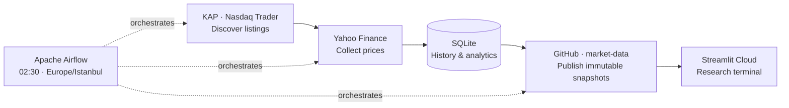

<div align="center">


# VULTURE CAPITAL

### The Patient Opportunist

**BIST · NASDAQ · NYSE**

*Zirvede kalabalık, dipte sessizlik. Biz sessizliği izleriz.*

[](https://vulture-capital.streamlit.app/)

[](requirements.txt)
[](dags/vulture_daily.py)
[](compose.yaml)

</div>

---

## The thesis

A research terminal for the patient, contrarian investor. Explore deep drawdowns, proximity to yearly lows and unusual volume across Turkish and US equities — with the price history and data freshness behind every observation.

**A fallen price is a starting point for research, never proof of value.**

## Inside the terminal

| Workspace | What it reveals |
| :--- | :--- |
| **Opportunity radar** | Distance to yearly lows, drawdowns and data-age filters |
| **Market radar** | Return rankings, volume anomalies and market breadth |
| **Stock explorer** | Adjusted price history, volume and period returns |
| **Compare** | Relative performance from a common starting point |
| **Data status** | Update results, new listings and unavailable symbols |

## One daily flight



New listings join the watchlist automatically. The dashboard reads published data; opening it does not trigger another market-data download. The VM must be running for daily updates; the cloud app remains available with the latest published data.

<details>
<summary><strong>Run locally</strong></summary>

Python 3.11–3.14.

```bash
git clone https://github.com/okankoken/Vulture_Capital.git
cd Vulture_Capital

python -m venv .venv
source .venv/bin/activate
pip install -r requirements.txt

python -m vulture.symbols
python -m vulture.pipeline
streamlit run app.py
```

[Daily publishing & deployment guide →](CLOUD_SETUP.md)

</details>

---

<div align="center">

**Observe the drawdown. Examine the evidence. Stay patient.**

Built by [**Okan Köken**](https://github.com/okankoken) · [Live dashboard](https://vulture-capital.streamlit.app/) · [Published data](https://github.com/okankoken/Vulture_Capital/tree/market-data)

<sub>Market research, not investment advice. Prices may be delayed; missing or stale data is identified in the app.</sub>

</div>
